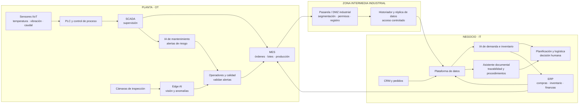

# Propuesta de transformación digital

## 1. Objetivo

Diseñar una transformación digital realista para una pyme agroalimentaria, explicando cómo se complementan la digitalización de planta (OT) y la digitalización del negocio (IT), y cómo la inteligencia artificial (IA) puede mejorar procesos de ambas áreas.

## 2. Digitalización en planta y en negocio

### Digitalización en planta (OT)

La tecnología operacional (OT, *Operational Technology*) conecta y supervisa máquinas, sensores y procesos físicos. En una planta de producción puede incluir sensores de temperatura y vibración, controladores PLC, sistemas SCADA y herramientas MES. Sus prioridades son la continuidad, la calidad, la seguridad de las personas y el control del proceso en tiempo real.

La IA puede analizar señales de máquinas para anticipar fallos, inspeccionar imágenes de producto y envase, detectar desviaciones en parámetros de proceso y ayudar a ajustar la planificación. Para evitar riesgos, las recomendaciones se validan primero con operadores y responsables de calidad; la IA no sustituye los enclavamientos ni los controles de seguridad industrial.

### Digitalización del negocio (IT)

La tecnología de la información (IT, *Information Technology*) soporta los datos y procesos administrativos y comerciales: compras, ventas, clientes, inventario, finanzas, recursos humanos y logística. Suele apoyarse en ERP, CRM y plataformas de datos.

La IA puede mejorar las previsiones de demanda, detectar patrones de devoluciones, priorizar pedidos y facilitar la búsqueda de información en documentos internos. Las decisiones con impacto comercial o sobre personas deben conservar revisión y responsabilidad humanas.

### Cómo se conectan

IT y OT intercambian información útil, pero no deben confundirse ni conectarse sin controles. Por ejemplo, el MES puede enviar cantidades producidas y lotes al ERP; el ERP devuelve un plan de producción. La arquitectura propuesta limita el intercambio a una zona intermedia controlada (DMZ industrial), con permisos, registro y segmentación de red.

## 3. Empresa seleccionada

**Oleum Sierra Verde, S.L.** es una empresa ficticia ubicada en Jaén, dedicada a producir y envasar aceite de oliva virgen extra.

| Característica | Supuesto del caso |
|---|---|
| Tamaño | Pyme de 65 personas |
| Actividad | Recepción de aceituna, extracción, almacenamiento, envasado y distribución |
| Instalaciones | Una almazara y dos líneas de envasado |
| Capacidad orientativa | Hasta 8 millones de litros por campaña |
| Productos | Aceite virgen extra en formatos de 250 ml a 5 l y venta a granel |
| Clientes | Distribuidores, cadenas de alimentación, hostelería y comercio electrónico |
| Retos | Estacionalidad, variabilidad de la materia prima, trazabilidad por lote, paradas, calidad y costes energéticos |

Las cifras sirven para contextualizar una propuesta académica y no describen una empresa real.

## 4. Tecnologías propuestas

Se proponen cinco tecnologías, combinando capacidades de planta y de negocio:

| # | Tecnología | Ámbito | Uso e impacto de la IA |
|---|---|---|---|
| 1 | Sensores IIoT, PLC, SCADA y MES | Planta (OT) | Capturan variables de proceso y producción. Los datos contextualizados permiten detectar desviaciones y correlacionar parámetros con calidad y rendimiento. |
| 2 | Visión artificial en el borde (edge AI) | Planta (OT) | Inspecciona cierres, etiquetas, nivel de llenado y defectos visibles en envases. Marca anomalías para que el operario las revise y documenta el resultado por lote. |
| 3 | Mantenimiento predictivo | Planta (OT) | Modelos analizan vibración, temperatura y horas de funcionamiento para estimar riesgo de fallo y planificar inspecciones antes de una parada. |
| 4 | ERP/CRM integrado con analítica y previsión de demanda | Negocio (IT) | Combina pedidos, ventas, campaña y estacionalidad para mejorar previsiones, compras, inventario y planificación de entregas. |
| 5 | Plataforma de datos y asistente documental con IA | IT y conexión controlada IT/OT | Consolida datos autorizados y ayuda a localizar registros de lote, procedimientos y certificados. Las respuestas enlazan con documentos fuente y requieren validación antes de usarse como evidencia. |

La quinta tecnología no debe recibir acceso directo de escritura a PLC/SCADA. Los datos OT pasan por una zona intermedia, con filtros, permisos de solo lectura cuando sea posible y monitorización.

## 5. Diagrama de arquitectura IT/OT

El diagrama editable está en [`diagrama.mmd`](diagrama.mmd).

El diagrama representa flujos de información, no un diseño de ingeniería para instalar. La conexión de negocio con MES debe concretarse mediante interfaces autorizadas y una arquitectura aprobada por responsables de OT, IT y ciberseguridad.

## 6. Propuesta y hoja de ruta

### Fase 1 — Preparación y línea base (meses 0–2)

- Nombrar responsables de planta, calidad, IT y ciberseguridad.
- Mapear equipos, sistemas, datos, riesgos y dependencias de operación.
- Definir qué datos se necesitan y quién puede consultarlos.
- Medir una línea base de paradas, defectos, energía por litro, error de previsión y roturas de stock.
- Acordar tratamiento de datos, retención, accesos, copias de seguridad y respuesta manual ante fallos.

### Fase 2 — Captura e integración controlada (meses 3–5)

- Instrumentar una máquina crítica y una línea de envasado como pilotos.
- Integrar eventos de producción y calidad en el MES/historiador.
- Crear pasarela segregada para el intercambio con IT y verificar permisos.
- Validar calidad y representatividad de los datos antes de entrenar modelos.

### Fase 3 — Pilotos de IA (meses 6–9)

- Probar visión artificial en un punto de inspección, comparando resultados con revisión humana.
- Probar alertas de mantenimiento en un equipo no crítico o con modo de recomendación.
- Generar previsiones de demanda en modo sombra, sin automatizar pedidos.
- Revisar falsos positivos, falsos negativos, sesgos de campaña y carga de trabajo.

### Fase 4 — Evaluación y escalado (meses 10–12)

- Comparar resultados con la línea base y los criterios acordados.
- Escalar únicamente los casos que aporten valor y sean seguros.
- Formar a operarios y equipos de negocio; mantener procedimientos manuales.
- Establecer seguimiento del rendimiento del modelo, cambios de datos y mecanismo de retirada.

## 7. Beneficios esperados e indicadores

Los siguientes valores son **objetivos preliminares para evaluar un piloto**, no resultados garantizados. Se confirmarán o modificarán con la línea base.

| Indicador | Objetivo orientativo a 12 meses | Proceso |
|---|---:|---|
| Tiempo de parada no planificada | Reducir 15 % | Mantenimiento |
| Rechazos por defectos detectables en línea | Reducir 20 % | Calidad y envasado |
| Consumo energético por litro | Reducir 8 % | Producción y energía |
| Error de previsión de demanda | Reducir 15 % | Ventas y planificación |
| Roturas de stock de referencias prioritarias | Reducir 10 % | Compras y logística |

**Beneficios para la empresa:** mayor disponibilidad de equipos, control de calidad más consistente, trazabilidad más rápida, inventario más equilibrado y decisiones basadas en datos.

**Beneficios potenciales para el sector:** mejor aprovechamiento de materia prima y energía, digitalización más accesible para pymes, mayor capacidad de demostrar trazabilidad y difusión de prácticas medibles de producción eficiente. El beneficio ambiental debe verificarse con mediciones; no se presupone automáticamente por incorporar IA.

## 8. Riesgos y medidas de control

| Riesgo | Medida |
|---|---|
| Datos incompletos o sensores mal calibrados | Validación, calibración, controles de calidad y registro de cambios |
| Falsas alarmas o defectos no detectados | Evaluación con muestras representativas, umbrales revisados y confirmación humana |
| Interrupción o acceso indebido a OT | Segmentación, mínimo privilegio, copias, monitorización y plan de operación manual |
| Dependencia excesiva de un proveedor/modelo | Documentar interfaces, exportar datos y disponer de procedimiento de sustitución |
| Uso incorrecto de respuestas generadas | Citar fuentes internas, restringir permisos y requerir verificación antes de tomar decisiones |
| Resistencia o brecha de competencias | Participación de trabajadores, formación y explicación de límites y responsabilidades |

La IA se considera un apoyo a la decisión, no un sustituto de controles de seguridad ni de la responsabilidad de las personas. La implantación debe respetar la normativa aplicable y revisar el nivel de riesgo de cada caso de uso.

## 9. Conclusión

La propuesta combina mejoras operativas en planta con una gestión más coordinada del negocio. El valor no proviene de instalar IA por sí sola, sino de disponer de datos fiables, conectar sistemas con seguridad, definir indicadores y validar cada piloto con las personas que conocen el proceso.
